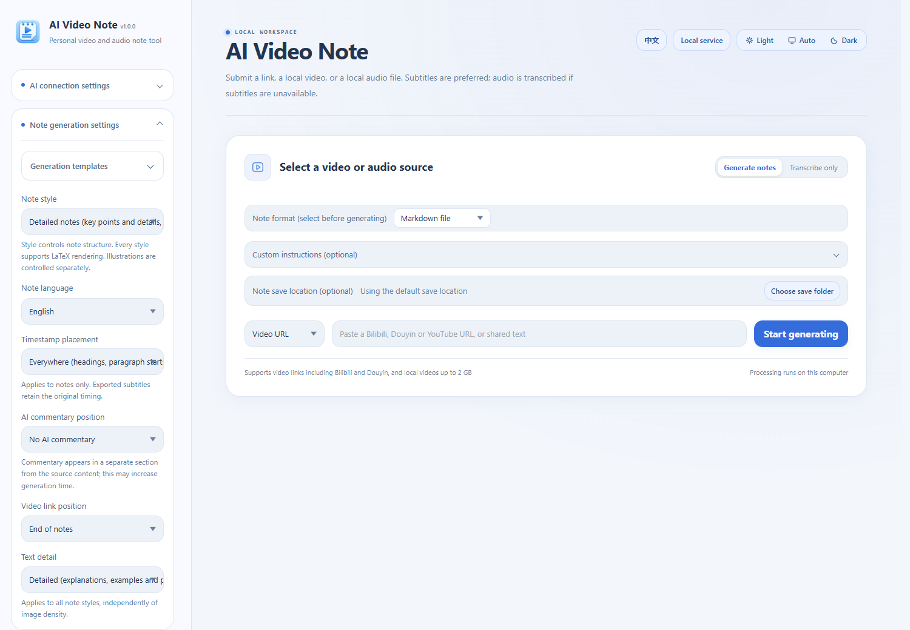
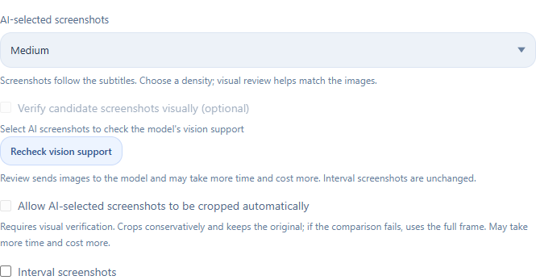

# AI Video Note

<p align="center">
  <a href="README.md"></a>
  &nbsp;
  <a href="README.en.md"></a>
  &nbsp;
  <a href="https://ko-fi.com/hehe1885"></a>
</p>

A local desktop tool that turns video and audio into notes. Submit a video link or local file, extract subtitles or transcribe speech, then use AI to review, organize and export the result. Switch between Chinese and English using the control in the top-right corner.

## Features

Bring media import, transcript preparation, illustrated AI notes and document or knowledge-base exports together in one interface.



*English interface example: choose a media source, note format, style, language and save location.*

### Video links and local media

- **Online links:** Bilibili, YouTube and Douyin, including shared text containing a video URL. Select individual parts of a multi-part Bilibili video.
- **Local files:** import video or audio to generate notes, or choose **Transcribe only** to keep a transcript without generating notes.
- **Material reuse:** reuse existing subtitles and cached audio or video when available to reduce repeated downloads and processing. Platform availability depends on network access, sign-in requirements and platform rules.

### Subtitles, local speech recognition and review

- Prefer reliable original-language subtitles, with local speech recognition when subtitles are unavailable. Supports multilingual Whisper models and Chinese Paraformer models.
- Download or manually import models and choose their storage location. Run on CPU or use a compatible GPU, with CPU fallback when acceleration is unavailable.
- Use AI transcript review and check passages that need confirmation. After generation, open **Compare and replay** to compare notes with source text and timestamps.
- Export **SRT subtitles** separately, preserving the original timing for editing and caption workflows.

### AI notes for different purposes

- Choose **Detailed notes, Key summary, Study guide, Step-by-step tutorial or Meeting minutes** for courses, tutorials, interviews and meetings.
- Set text detail to brief, standard or detailed. Generate Chinese or English notes and choose where timestamps, source links and a separate AI commentary section appear.
- Add custom instructions, render LaTeX formulas, and save or apply generation templates to reuse frequently used settings.

### AI illustrations from video frames

**AI illustrations use timestamped transcripts to select real frames from the source video and place them near the relevant points in your notes.** Image density and text detail are independent, making this useful for slides, charts and demonstrations.

- **Image density:** choose no images, few, medium or many. AI plans screenshot timestamps based on the content.
- **Visual verification (optional):** when the selected model supports vision, check whether candidate frames match the associated explanation to reduce irrelevant or mistimed images.
- **Automatic cropping (optional):** with visual verification enabled, let AI select a relevant region. Original images are retained; the full frame is used if the crop fails verification.
- **Timed screenshots:** specify a fixed interval to capture frames at regular times instead of using AI-selected timestamps.
- **Quality and attachments:** configure screenshot video quality, encoding and cache location. Images are saved according to the chosen export format; Obsidian supports separate attachments with relative links.

<p align="center">
  
</p>

*AI illustration settings example. Visual verification and cropping require a working vision model and send candidate images to the selected service or client, which may add processing time and cost. Audio-only sources have no video frames to capture.*

### API and Agent workflows

- **API mode:** configure your model service, endpoint and API key. The app calls the model for transcript review, screenshot selection and note generation.
- **Agent mode:** let an external AI client process prepared materials through MCP or the included Skill, with results returned to the app. Manual result submission is also available as a fallback.
- Configure the note-writing model separately from local speech recognition. Agent workflows require an available external client and its model; API workflows may incur provider charges.

### Exports and knowledge-base integration

| Use case | Supported output |
| --- | --- |
| Everyday notes and document editing | Markdown, Word (DOCX), plain text (TXT) |
| Reading, printing and web sharing | PDF, HTML, PNG as a long image or 3:4 pages |
| Knowledge-base organization | Obsidian vaults, Evernote (ENEX) |
| Further processing and subtitles | JSON, SRT subtitles |

Choose where to save notes. For Obsidian, configure note folders, attachment locations, tags and callouts. Open the output file or its folder, or copy its path directly after generation.

### History, progress and cache management

- Process long tasks in segments, show stages, progress and logs, and save intermediate materials. Reopen historical tasks or regenerate notes from existing materials.
- Filter history by title, status, output type and date to find and manage earlier work.
- View storage statistics and clean audio/video caches. Opening the cleanup dialog previews the files; **Clean cache** performs the deletion. Notes, subtitles, screenshots, history and models are preserved.
- Manage or delete models separately, import and export settings, check the environment and repair dependencies.

### Desktop experience

Windows system tray, optional startup with Windows, Chinese and English interfaces, light / dark / system themes, and keyboard access for common controls and dialogs. Updates preserve the workspace and existing startup preference. Uninstalling removes startup entries belonging to the current installation while retaining user data.

## Windows installer (recommended)

Download `AI-Video-Note-VERSION-Setup-x64.exe` from the repository's GitHub Releases, choose English or Chinese, and follow the wizard. The installer includes Python and the required runtime dependencies, so a separate Python installation is unnecessary. Speech recognition models are downloaded as needed; no personal settings or account data are included.

The default location is `%LOCALAPPDATA%\Programs\AI Video Note`. Installation is per user and does not require administrator privileges. You can choose another writable folder. A Start menu entry is created, with an optional desktop shortcut.

Settings, history, notes and models default to `workspace/` inside the installation folder. Before upgrading, quit through the system tray, then run the new installer and reuse the same folder. Updates replace only program files and preserve settings, credentials, notes, models and custom data folders. Uninstalling first exits this installation and its worker processes, then deletes program files and the workspace inside the installation directory. Back up data you need before uninstalling. Custom folders outside the installation are preserved. Remaining processes or files cause an explicit uninstall failure.

## Running the source on Windows

1. Install **64-bit Python 3.11–3.14** and make sure `py` or `python` is available.
2. Download and extract the source, or clone the repository into a writable folder.
3. Double-click `start.bat`. On first launch it creates `.venv`, installs Python dependencies, and checks or downloads the Node.js runtime needed for YouTube. Internet access is required.
4. In the browser interface, select English or Chinese and configure your own AI connection.
5. If speech recognition is needed, download a model using model management. **No installed models are included in the source.**
6. Submit a link or local media file, choose the output options and start processing.

The service listens only on the local computer by default, using `127.0.0.1`. The launcher looks for an available port starting at `8765`; use the address it opens. Closing the browser can leave the app running in the system tray. Use the tray menu to quit.

If dependency installation fails, run `repair.bat` or use the environment check and repair controls in software settings. Initial setup, model downloads and online media downloads require internet access. Local speech recognition can run offline after model installation. Whether note generation needs the internet depends on the selected AI connection.

### Command line and development

In Windows PowerShell:

```powershell
# Prepare the environment and start; -Foreground displays logs in the terminal
.\start.ps1 -Foreground

# Stop a service managed by the startup scripts
.\stop.ps1
```

On other systems, create a Python virtual environment, install the dependencies and run the service manually. Windows tray integration, native dialogs and GPU installation helpers depend on the corresponding platform. Main source entry points:

```bash
python -m venv .venv
# After activating the virtual environment:
python -m pip install -r backend/requirements.txt
python launcher.py --console
```

YouTube downloads need Node.js 20 or newer. Formula images in some exports require a local Edge or Chrome installation. GPU acceleration also requires compatible drivers and runtime components; follow the instructions in the app.

## Models and AI configuration

Local speech recognition and the model used to write notes are separate settings. The former transcribes audio; the latter reviews and writes content. Select your models, CPU/GPU backend and AI service in the app.

The API workflow uses your own API key and may incur provider charges. An Agent workflow processes materials through the connected client. It does not require a note-generation API key in this app, but that client must have a working model configured.

When a platform requires Bilibili or Douyin sign-in, use your own account. Do not upload cookies, API keys or exported personal settings to a public repository.

## Data and privacy

This source distribution starts with a clean state. It **does not include the author's tasks, media, notes, account sessions, API keys, personal preferences, logs, installed models or Python environment**.

- User data defaults to `workspace/`; models default to `workspace/_model_cache/`. Custom folders can be configured in the app.
- `.venv/` and `.runtime/` are generated during use and are not distributed with the source.
- Local speech recognition runs on your computer. When you select an online AI service or Agent, relevant text and selected images or other materials are sent to that service or client. A local interface does not mean every processing step is offline.
- `.env.example` contains example values only. If needed, copy it to `.env` and configure it yourself. Do not commit real settings.
- `.gitignore` excludes the workspace, environments, models, logs and common credential files. Review your own staged changes before sharing.

Before cleaning an existing installation, quit the app and back up anything you need. The workspace may contain notes and original uploads. Custom model, download and export folders may also be outside the project.

## Tests and builds

```bash
python -m pip install -r backend/requirements-dev.txt
python -m pytest
node scripts/check_frontend.cjs
```

On Windows, build a portable executable with the following command. Build dependencies and compatible C++ runtime libraries are required.

```powershell
.\scripts\build_exe.ps1 -Python .\.venv\Scripts\python.exe

# Build a bilingual installer (also requires Inno Setup 7 or 6 and Simplified Chinese messages)
.\scripts\build_installer.ps1 -Python .\.venv\Scripts\python.exe
```

The repository includes cross-platform test workflows and a Windows release workflow. Pushing a `v*` tag that matches the version in `launcher.py` triggers verification, a build and a GitHub Release. Running the release workflow manually only creates build artifacts for testing. Prebuilt executables are not included in the source tree.

## Project layout

| Directory | Contents |
| --- | --- |
| `backend/` | Local service, tasks, speech recognition, AI processing and exports |
| `frontend/` | Browser UI, Chinese/English text and local static assets |
| `skills/AI-Video-Note/` | Agent Skill and helper scripts |
| `scripts/` | Environment setup, checks and build tools |
| `tests/` | Backend and frontend regression checks |
| `sources/` | Application icons |

## Support development

If this project is useful to you, you can buy me a coffee at [Ko-fi: hehe1885](https://ko-fi.com/hehe1885). Bug reports and contributions are welcome too.

## License and acknowledgments

This project uses the [MIT License](LICENSE) and retains the existing copyright notice. Open-source dependencies, models and platform content have their own licenses and terms. Notices for bundled third-party resources are retained with those resources.
