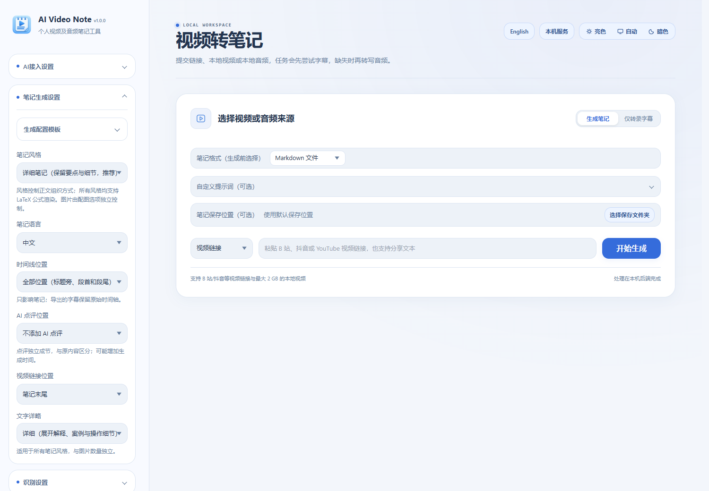
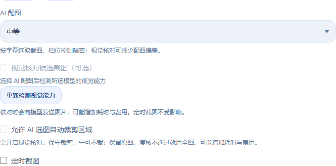

# AI Video Note

<p align="center">
  <a href="README.md"></a>
  &nbsp;
  <a href="README.en.md"></a>
  &nbsp;
  <a href="https://ko-fi.com/hehe1885"></a>
</p>

把视频和音频整理成笔记的本地桌面工具。提交视频链接或本地文件，提取字幕或识别语音，再由 AI 校对、整理和导出。界面支持中文与英文，可在右上角切换。

## 功能

从获取素材、整理字幕到生成图文笔记，再保存到常用的文档和知识库格式，可在一个界面中完成。



*中文界面示例：选择媒体来源、笔记格式、风格、语言和保存位置。*

### 视频链接与本地媒体

- **在线链接**：支持 Bilibili、YouTube 和抖音，也可直接粘贴包含视频链接的分享文本；Bilibili 多分 P 视频可勾选需要处理的分集。
- **本地文件**：导入视频或音频，既能生成笔记，也能选择「仅转录字幕」保留转写材料。
- **材料复用**：已有字幕、音频和视频缓存可在适用时复用，减少重复下载和处理。在线平台可用性受网络、登录状态和平台规则影响。

### 字幕提取、本地语音识别与校对

- 优先获取可靠的原文字幕，缺失时再进行本地语音识别；支持 Whisper 多语言模型与中文 Paraformer 模型。
- 可按需下载或手动导入模型，配置存储位置；提供 CPU 运行与兼容显卡的 GPU 加速，不可用时回退 CPU。
- 支持 AI 转写校对及待确认内容检查；生成后可打开「字幕对照与回看」，对照原字幕和时间点复核笔记。
- 可单独导出 **SRT 字幕**，保留原始时间轴，方便后续剪辑和字幕处理。

### 按用途生成 AI 笔记

- 提供 **详细笔记、重点摘要、学习讲义、步骤教程、会议纪要** 等风格，适合课程、教程、访谈和会议等内容。
- 文字详略可选简略、标准、详细；可选择中文或英文笔记，调整时间线、原视频链接和独立 AI 点评的位置。
- 支持自定义提示词、LaTeX 公式渲染，以及保存、应用和管理生成配置模板；模板可复用常用参数。

### AI 插图：智能选取视频画面

**AI 配图会结合带时间轴的字幕，从原视频提取真实截图，并插入笔记中相关知识点附近。** 图片疏密与文字详略分别设置，适合保留课件、图表和操作演示。

- **图片疏密**：可选不贴图片、较少、中等、较多，由 AI 根据内容规划截图时间点。
- **视觉核对（可选）**：所选模型具备视觉能力时，可检查候选画面与讲解内容是否对应，减少无关或错位配图。
- **自动裁剪（可选）**：开启视觉核对后，可允许 AI 选择相关区域；保留原图，裁剪复核不通过时使用完整画面。
- **定时截图**：也可自行指定截图间隔；启用后按间隔提取画面，替代 AI 选点。
- **清晰度与附件**：可配置截图视频清晰度、编码和缓存位置；导出时按相应格式保存图片，Obsidian 支持独立附件和相对路径引用。

<p align="center">
  
</p>

*AI 配图设置示例。视觉核对和自动裁剪需可用的视觉模型，会发送候选图片给所选服务或客户端，可能增加耗时与费用；音频素材没有可提取的视频画面。*

### API 与 Agent 两种 AI 接入方式

- **API 模式**：配置自己的模型服务、接口地址和 API Key，由软件调用模型完成校对、选图与笔记生成。
- **Agent 模式**：通过 MCP 或配套 Skill 让外部 AI 客户端处理准备好的材料，生成结果可回到软件中；也提供手动提交结果的备用流程。
- 笔记大模型与本地语音识别模型分别配置。Agent 路线需要可用的外部客户端及其模型，API 路线可能产生服务商费用。

### 多格式导出与知识库保存

| 用途 | 支持方式 |
| --- | --- |
| 日常笔记与文档编辑 | Markdown、Word（DOCX）、纯文本（TXT） |
| 阅读、打印与网页分享 | PDF、HTML、PNG 长图或 3:4 分页图片 |
| 知识库整理 | Obsidian 仓库、Evernote / 印象笔记（ENEX） |
| 后续处理与字幕制作 | JSON、SRT 字幕 |

可选择笔记保存文件夹；Obsidian 可设置笔记目录、附件位置、标签和提示块。生成后可直接打开文件、打开所在文件夹或复制路径。

### 历史记录、进度与缓存管理

- 长任务分段处理，显示处理阶段、进度和运行记录，保存中间材料；可查看历史任务并复用材料重新生成。
- 历史记录支持按标题、状态、内容类型和日期筛选，方便查找、回看和管理。
- 提供存储统计与音视频缓存清理；打开清理窗口即预览待清理文件，再点击「清理缓存」执行。清理会保留笔记、字幕、截图、历史记录和模型。
- 模型可单独管理和删除；支持设置导入、导出与环境检查、依赖修复。

### 桌面使用体验

Windows 系统托盘、可选开机启动、中英文界面、亮色 / 暗色 / 跟随系统主题，以及常用控件和弹窗的键盘操作。更新保留工作区和原有开机启动设置；卸载清理属于当前安装的开机启动项，保留用户数据。

## Windows 安装版（推荐）

在仓库的 GitHub Releases 中下载 `AI-Video-Note-版本号-Setup-x64.exe`，选择中文或英文并按向导安装。安装版自带 Python 和必要运行依赖，无需事先安装 Python；语音识别模型按需下载，不附带个人配置或账号数据。

默认安装到 `%LOCALAPPDATA%\Programs\AI Video Note`，只为当前用户安装，无需管理员权限，也可以自行选择其他可写目录。开始菜单会创建入口，桌面快捷方式可选。

配置、历史、笔记和模型默认位于安装目录下的 `workspace/`。升级前从系统托盘退出软件，运行新版安装包并沿用原目录；安装包只替换程序文件，保留整个工作区和自定义数据目录。卸载也会保留这些个人数据。

## Windows 源码版快速开始

1. 安装 **64 位 Python 3.11–3.14**，确保 `py` 或 `python` 可用。
2. 下载并解压本仓库源码，或使用 Git 克隆到可写目录。
3. 双击 `start.bat`。首次启动会创建 `.venv`、安装 Python 依赖，并检查或下载 YouTube 所需的 Node.js 运行组件，需要联网。
4. 在浏览器打开的软件界面中选择中文或 English，配置自己的 AI 通道。
5. 如需语音识别，在模型管理中下载所需模型。**源码不附带任何已安装模型。**
6. 提交链接或本地媒体，选择输出选项并开始处理。

默认仅监听本机 `127.0.0.1`；启动器默认从 `8765` 端口开始寻找可用端口，以实际打开的地址为准。关闭浏览器后软件仍可在托盘运行，退出请使用托盘菜单。

依赖安装失败时可运行 `repair.bat`，或在软件设置中使用环境检查与修复。首次安装、下载模型和下载视频需要网络；本地语音识别在模型安装后可离线运行。生成笔记是否联网取决于所选 AI 通道。

### 命令行与开发

在 Windows PowerShell 中：

```powershell
# 准备环境并启动；可加 -Foreground 在终端查看日志
.\start.ps1 -Foreground

# 停止由启动脚本管理的服务
.\stop.ps1
```

其他系统可自行创建 Python 虚拟环境并安装依赖，然后运行服务；Windows 托盘、原生窗口和 GPU 安装向导等功能依赖相应平台。源码中的主要入口：

```bash
python -m venv .venv
# 激活虚拟环境后：
python -m pip install -r backend/requirements.txt
python launcher.py --console
```

YouTube 下载需要 Node.js 20 或更新版本。部分导出中的公式图片需要本机 Edge 或 Chrome；GPU 加速还需要兼容的驱动和运行组件，可通过软件内提示配置。

## 模型与 AI 配置

本地语音识别模型与笔记大模型是两类配置：前者负责识别音频，后者负责校对和写作。可在软件中选择适合自己的模型、CPU/GPU 后端以及 AI 服务。

API 路线使用你自己的 API Key，可能产生服务商费用。Agent 路线由所连接的客户端处理材料，不要求在本软件中填写笔记 API Key，但需要该客户端已配置可用模型。

需要 Bilibili 或抖音登录时，使用自己的账号完成登录。不要把 Cookie、API Key 或导出的设置发到公共仓库。

## 数据与隐私

这个源码发布包从空白状态开始，**不包含作者的任务、媒体、笔记、账号登录状态、API Key、个人偏好、日志、已安装模型或 Python 环境**。

- 默认用户数据位于 `workspace/`，模型默认位于 `workspace/_model_cache/`；自定义目录可在软件中配置。
- `.venv/` 和 `.runtime/` 在使用时生成，不随源码分发。
- 本地语音识别在本机执行。选择在线 AI 或 Agent 服务时，相应的文字与选中的图片等材料会发送给所选服务或客户端；“本地界面”不表示所有处理都离线。
- 仓库提供的 `.env.example` 只有示例值。需要时复制为 `.env` 并自行配置，不要提交真实配置。
- `.gitignore` 已排除工作区、环境、模型、日志和常见凭据文件；分享前仍应检查自己的 Git 暂存内容。

需要清理自己的安装时，先退出软件并备份需要的文件。工作区可能包含笔记和原始上传文件；自定义的模型、下载和导出目录也可能位于项目之外。

## 测试与打包

```bash
python -m pip install -r backend/requirements-dev.txt
python -m pytest
node scripts/check_frontend.cjs
```

Windows 可使用以下命令生成便携可执行文件（需要相应构建依赖和 C++ 运行库）：

```powershell
.\scripts\build_exe.ps1 -Python .\.venv\Scripts\python.exe

# 制作中英文安装包（还需 Inno Setup 7 或 6 与简体中文语言文件）
.\scripts\build_installer.ps1 -Python .\.venv\Scripts\python.exe
```

仓库包含跨平台测试工作流和 Windows 发布工作流。推送与 `launcher.py` 中版本号一致的 `v*` 标签，会触发验证、构建和 GitHub Release；手动运行发布工作流只构建供测试的附件。源码不包含预构建的可执行文件。

## 项目结构

| 目录 | 内容 |
| --- | --- |
| `backend/` | 本地服务、任务、识别、AI 整理与导出 |
| `frontend/` | 浏览器界面、中英文文案及本地静态资源 |
| `skills/AI-Video-Note/` | Agent Skill 与调用脚本 |
| `scripts/` | 环境准备、检查与打包工具 |
| `tests/` | 后端与前端回归检查 |
| `sources/` | 应用图标 |

## 支持开发

如果这个项目对你有帮助，欢迎通过 [Ko-fi：hehe1885](https://ko-fi.com/hehe1885) 请我喝杯咖啡。也欢迎反馈问题和提交改进。

## 许可证与致谢

本项目使用 [MIT License](LICENSE)，保留原有版权声明。所用开源依赖、模型和平台内容遵循各自许可证及使用条款；第三方资源的声明随对应资源保留。
